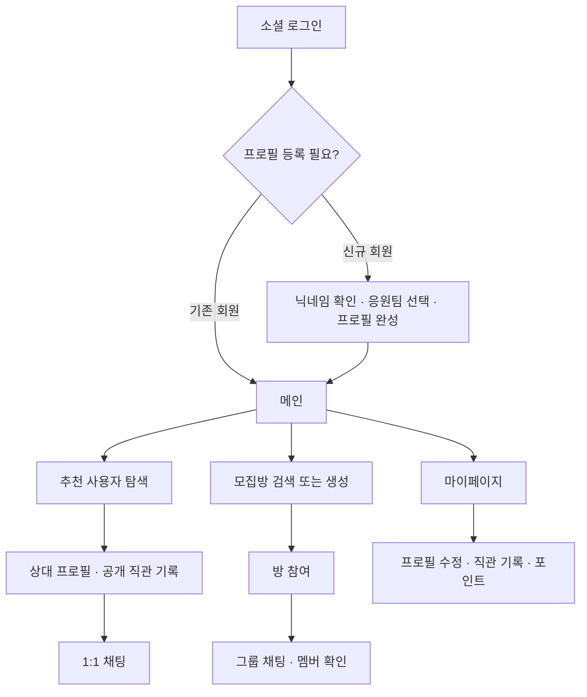

# jikchin
sports_mate_app

Flow Chart


## 백엔드 패키지 구조

도메인별로 관련 코드를 모으고, 각 도메인 안에서 Controller, Service, DTO, 도메인 모델, Repository의 역할을 구분합니다.

```text
com.jikchin.jikchin_app
├── auth
│   ├── config           # 인증 설정
│   ├── controller       # 로그인·최초 프로필 등록 API
│   ├── converter        # 소셜 로그인 제공자 변환
│   ├── domain           # 소셜 로그인 제공자 모델
│   ├── dto              # 인증 요청·응답·서비스 입출력
│   ├── infrastructure   # OAuth API·JWT 구현
│   ├── port             # OAuth·토큰 처리 인터페이스
│   ├── security         # 인증 필터·현재 사용자
│   └── service          # 로그인 처리
├── user                 # 회원·프로필: controller, dto, domain, repository, service
├── game                 # 경기·구단·리그·경기장: domain, repository
├── chat                 # 채팅방·참여자·메시지·첨부 모델
├── record               # 직관 기록·사진 모델
├── point                # 포인트 계정·원장·충전 모델
├── media                # 공용 미디어 모델
├── moderation           # 신고 접수·사유·차단 API와 모델
└── global               # 공통 설정·생성/수정 시간 관리
```

- Controller는 Service를 호출하고, Service는 Spring Data Repository로 데이터를 조회·저장합니다.
- OAuth·JWT 처리는 `auth.port`의 인터페이스와 `auth.infrastructure`의 구현으로 분리합니다.
- HTTP 요청·응답 DTO와 JPA 엔티티는 분리하고, 도메인 모델은 Controller나 외부 API 구현을 참조하지 않습니다.
- 모집방 기능을 구현할 때는 별도 `room` 패키지에 추가합니다.

## DB 마이그레이션

MySQL 스키마는 Flyway로 관리합니다. 애플리케이션 시작 시 `src/main/resources/db/migration`의 SQL을 버전 순서대로 적용한 뒤, JPA가 엔티티와 DB 구조를 검증합니다. `V1__init_schema.sql`은 현재 엔티티 18개의 테이블, 외래 키, 고유 제약 조건과 인덱스를 생성합니다.

로컬 MySQL에 빈 DB를 먼저 준비합니다.

```sql
CREATE DATABASE IF NOT EXISTS jikchin
    CHARACTER SET utf8mb4
    COLLATE utf8mb4_unicode_ci;
```

IntelliJ의 애플리케이션 실행 환경변수에 DB 연결값과 기존 인증·이미지 설정을 지정합니다.

| 환경변수 | 값 |
| --- | --- |
| `DB_URL` | `jdbc:mysql://127.0.0.1:3306/jikchin?serverTimezone=Asia/Seoul&characterEncoding=UTF-8` |
| `DB_USERNAME` | 로컬 MySQL 사용자 |
| `DB_PASSWORD` | 해당 사용자의 비밀번호 |
| `JWT_SECRET` | JWT 서명용 랜덤 비밀키 |
| `GOOGLE_CLIENT_ID` | Google OAuth 웹 클라이언트 ID |
| `ASSETS_BASE_URL` | 이미지 제공 기본 URL |

`JPA_DDL_AUTO`의 기본값은 `validate`입니다. 이전에 실행 설정에 `JPA_DDL_AUTO=update`나 `create`를 넣었다면 삭제하거나 `validate`로 바꿉니다. 테이블 변경은 Flyway가 담당하도록 유지합니다. 로컬 기동 확인용 OAuth·이미지 임시값을 쓰는 경우 실제 기능 연동 전에 교체합니다.

서버 실행 후 다음 SQL로 적용 결과를 확인할 수 있습니다.

```sql
SHOW TABLES FROM jikchin;
SELECT version, description, script, checksum, installed_on, success
FROM jikchin.flyway_schema_history
ORDER BY installed_rank;
```

- 새 변경은 `V2__설명.sql`, `V3__설명.sql`처럼 버전 뒤에 밑줄 두 개를 붙인 새 파일로 작성합니다. SQL과 엔티티 변경을 함께 커밋합니다.
- 이미 적용한 버전의 파일을 수정하지 않습니다. Flyway는 체크섬으로 기존 파일의 변경을 검사합니다.
- `V2__auth_refresh_sessions.sql`은 로그인 갱신 토큰의 해시와 만료 시각을 저장하는 테이블을 추가합니다. 기존 DB도 서버 시작 시 V2를 적용해야 합니다.
- `V3__onboarding_teams.sql`은 2026년 KBO와 K리그1 팀을 추가하고 가입 화면에 표시할 팀을 지정합니다. 기존 이름이 같은 팀은 유지합니다. 로고 URL은 준비되지 않아 빈 값이며, 시즌에 따라 팀 목록을 별도 마이그레이션으로 갱신해야 합니다.
- 재시작 시 적용 완료한 SQL은 다시 실행하지 않습니다.
- 기존 테이블이 있는데 Flyway 이력이 없는 DB는 자동 baseline하지 않고 시작을 중단합니다. 기존 데이터가 있다면 백업과 스키마 비교 후 명시적으로 baseline을 계획합니다. 새 개발 환경은 빈 DB로 연결하면 됩니다.
- Flyway의 `clean`은 비활성화되어 있습니다. MySQL DDL은 실패 시 전체 롤백되지 않을 수 있으므로 실패한 마이그레이션은 오류와 실제 적용 상태를 확인한 뒤 복구합니다.

## Docker로 로컬 서버 실행

Docker Desktop을 실행한 후 이 디렉터리에 `.env`가 없다면 예시 파일을 복사합니다. 기존 `.env`는 덮어쓰지 않습니다.

```powershell
if (-not (Test-Path .env)) { Copy-Item .env.example .env }
```

예시 파일에서 복사한 경우 `.env`의 `MYSQL_PASSWORD`, `MYSQL_ROOT_PASSWORD`, `JWT_SECRET`을 로컬 전용 값으로 교체하고, `GOOGLE_CLIENT_ID`에는 Android의 `GOOGLE_WEB_CLIENT_ID`와 같은 Google 웹 클라이언트 ID를 설정합니다. JWT 비밀키는 UTF-8 기준 32바이트 이상이어야 합니다. `ASSETS_BASE_URL`은 실제 이미지 제공 주소로 변경하세요. 예시 주소는 서버 기동 확인용이며 이미지가 표시되지 않습니다. `.env`는 Git과 Docker 빌드 컨텍스트에서 제외됩니다.

```powershell
docker compose up --build -d
docker compose ps
docker compose logs -f app
```

Compose는 별도의 MySQL 8과 서버를 실행합니다. MySQL 초기화가 끝나면 서버가 시작되고 Flyway가 마이그레이션을 적용한 뒤 JPA가 스키마를 검증합니다. Swagger는 `http://localhost:8080/swagger-ui/index.html`에서 확인할 수 있습니다. 다른 프로그램이 포트를 사용 중이면 `.env`의 `APP_PORT` 또는 `MYSQL_PORT`를 변경하세요.

MySQL Workbench에서는 `127.0.0.1:3307`, 사용자 `jikchin_app`, `.env`의 `MYSQL_PASSWORD`, DB `jikchin`으로 접속합니다. 기존 노트북 MySQL과 Docker MySQL은 서로 다른 DB이며, Docker DB는 `mysql_data` 볼륨에 저장됩니다. MySQL 초기 계정과 비밀번호는 볼륨 최초 생성 시 설정되므로, 이후 `.env`만 바꿔서는 기존 DB 계정이 바뀌지 않습니다.

Android 에뮬레이터의 기본 `BASE_URL`은 `http://10.0.2.2:8080/`입니다. 실제 휴대전화에서 접속하려면 로컬 네트워크에 맞는 서버 주소와 방화벽 설정이 필요하고, `.env`의 `APP_BIND_ADDRESS`를 접근 가능한 주소로 변경해야 합니다. 기본값은 노트북 내부에서만 접근 가능한 `127.0.0.1`입니다.

```powershell
docker compose down
```

위 명령은 컨테이너를 정지하지만 DB 볼륨은 보존합니다. `docker compose down -v`는 Docker DB 볼륨까지 삭제하므로 데이터를 지울 때만 사용하세요. 기존 노트북 MySQL의 DB는 Docker 볼륨과 별개입니다.

GitHub Actions의 `docker-smoke` 작업은 예시 설정으로 Docker 이미지와 별도의 MySQL을 실행하고 API 문서가 응답하는지 확인합니다. 이 작업은 CI의 임시 DB를 사용하며 실행이 끝나면 정리합니다.

## 테스트

```powershell
.\gradlew.bat test
```

테스트는 `src/test/resources/application-test.yml`의 테스트 전용 H2 DB와 테스트용 인증 설정을 사용합니다. 로컬 MySQL이나 실제 소셜 로그인 계정 없이 실행할 수 있습니다.

로그인·프로필 등록 서비스, 기존 API의 경로·응답 형식·요청 검증, 전체 애플리케이션 기동을 확인합니다. 운영 DB는 기존과 같이 MySQL을 사용하며, H2 테스트는 실제 MySQL에서의 호환성 검증을 대체하지 않습니다.

CI에서도 테스트를 포함한 전체 빌드를 실행합니다.

## 방 생성

- 프로필 등록을 완료한 사용자는 `POST /api/rooms`에 `title`, `gameDate`(YYYY-MM-DD), `stadium`, `homeTeamId`, `awayTeamId`, `capacity`를 전달해 방을 생성합니다. 제목과 경기장은 각각 100자 이하, 날짜는 오늘 이후, 인원은 방장 포함 2~100명입니다. 두 팀은 같은 리그의 서로 다른 선택 가능한 팀이어야 합니다.
- 생성 시 그룹 채팅과 방장의 참여 정보가 하나의 트랜잭션으로 저장됩니다. 응답에는 방 ID, 채팅방 ID, 방장 ID 및 입력한 경기 정보가 포함됩니다. 한 사용자는 여러 방을 생성할 수 있습니다.
- `GET /api/rooms/mine`으로 직접 생성하거나 참여한 방을 확인합니다. 경기 일정과 경기장 이름은 사용자가 입력한 정보이며 공식 일정과 대조하지 않습니다. 방 참여자는 실시간 텍스트 채팅을 이용할 수 있습니다.
- `V4__create_rooms.sql`을 서버 시작 시 적용해야 합니다.

## 방 참여

- 프로필 등록을 완료한 사용자는 `GET /api/rooms`로 경기 날짜가 오늘 이후인 방 목록을 조회합니다. 가까운 경기 날짜 순서이며, 정원이 찬 방도 현재 참여 인원과 함께 표시합니다.
- `POST /api/rooms/{roomId}/participants`로 방에 참여합니다. 요청 본문 없이 일반 액세스 토큰을 전달하며, 성공하면 `200 OK`와 방 생성 응답과 같은 필드의 방 정보(`chatThreadId`, `participantCount` 포함)를 반환합니다. 기존 그룹 채팅의 참여자로 등록되며 새 채팅방을 만들지 않습니다.
- 한 사용자가 여러 방에 참여할 수 있습니다. 방장이나 이미 참여한 사용자가 다시 요청하면 기존 참여 정보를 유지하고 `200 OK`를 반환합니다.
- 존재하지 않는 방은 `404`, 정원이 찼거나 경기 날짜가 지난 방에 새로 참여하려는 요청은 `409`를 반환합니다. 인증이 없으면 `401`, 프로필 등록 전이면 `403`입니다.
- 동시 참여 요청은 방 단위 DB 잠금으로 처리하고, 참여 인원 조회에는 `READ_COMMITTED`를 사용합니다. 방장 포함 정원을 초과하지 않으며, `(chat_thread_id, user_id)` 고유 제약 조건으로 중복 참여를 방지합니다. `V5__unique_chat_participants.sql`은 서버 시작 시 자동 적용됩니다.

## 방 나가기

- `DELETE /api/rooms/{roomId}/participants/me`로 본인이 참여한 방에서 나갑니다. 요청 본문 없이 일반 액세스 토큰을 전달하며, 성공하면 응답 본문 없는 `204 No Content`를 반환합니다.
- 해당 방의 본인 참여 정보만 삭제합니다. 내 방 목록에서 제외되고 현재 참여 인원과 빈자리에 반영됩니다. 다른 방의 참여 정보는 유지합니다.
- 방이 존재하는 동안은 이미 나갔거나 참여하지 않은 사용자가 다시 요청해도 `204`입니다. 경기 날짜가 지난 방에서도 나갈 수 있고, 나간 방이 참여 가능한 상태라면 기존 참여 API로 다시 들어갈 수 있습니다.
- 방장이 나가면 현재 남아 있는 참여자 중 입장 시각이 가장 이른 사람에게 방장을 자동 위임합니다. 입장 시각이 같으면 참여 정보 ID 순서로 결정합니다. 이미 나간 사람은 제외하며, 다시 참여한 사람은 재입장 시점부터 순서를 계산합니다. 이후 방 조회·참여 응답의 `hostId`는 새 방장입니다.
- 방장 혼자 남아 있을 때 나가면 방과 채팅, 참여 정보, 메시지 및 메시지 첨부 연결을 함께 삭제합니다. 첨부의 원본 미디어는 유지합니다. 그 방을 다시 요청하면 `404`입니다.
- 존재하지 않는 방은 `404`, 인증이 없거나 유효하지 않으면 `401`, 프로필 등록 전이면 `403`입니다.
- 입장과 동일한 방 단위 DB 잠금 및 `READ_COMMITTED`를 사용해 동시 입퇴장 시에도 정원과 참여 정보를 일관되게 처리합니다.
- `V6__add_room_host.sql`이 기존 방의 생성자를 최초 방장으로 설정합니다. 방장 위임 후에도 채팅 생성자 기록은 보존합니다.
## 방 상세·참여자 조회

- `GET /api/rooms/{roomId}`는 방 ID, 채팅방 ID, 제목, 경기 날짜·경기장, 홈·원정 팀 ID와 이름, 최대 인원, 방장 ID, 현재 참여 인원을 반환합니다. 방 생성·목록 응답과 같은 `RoomResponse` 형식입니다.
- `GET /api/rooms/{roomId}/participants`는 해당 방의 참여자 목록을 참여 시각 순서로 반환합니다. 참여 시각이 같으면 참여 기록 ID 순서로 정렬합니다. 각 항목은 `userId`, `nickname`, `avatarUrl`, `host`(방장 여부), `joinedAt`을 포함합니다.
- 두 API 모두 프로필 등록을 완료한 사용자가 참여 전에도 조회할 수 있습니다. 경기 날짜가 지났거나 정원이 찬 방도 조회할 수 있습니다. 조회만으로 참여 정보가 생성되지 않습니다.
- 사진 URL은 `ASSETS_BASE_URL`과 저장된 사진 키로 구성합니다. 프로필이 없는 기존 참여 기록도 목록에 포함하며, 이 경우 `nickname`은 null이고 기본 사진 URL을 반환합니다.
- 존재하지 않는 방은 `404`, 인증이 없으면 `401`, 프로필 등록 전이면 `403`입니다. 기존 테이블을 사용하므로 추가 DB 마이그레이션은 없습니다.

## 방 채팅

- WebSocket `/ws/chat`에 접속하고 STOMP `CONNECT`의 `Authorization: Bearer ...` 헤더로 인증합니다. 메시지 전송은 `/app/rooms/{roomId}/messages`, 실시간 수신은 `/topic/rooms/{roomId}/messages`입니다.
- `GET /api/rooms/{roomId}/messages`는 저장된 대화를 조회하고, `POST`는 HTTP로 메시지를 전송합니다. HTTP로 보낸 메시지도 같은 WebSocket 구독자에게 전달됩니다.
- 현재 방 참여자만 이용할 수 있습니다. 참여 이전 대화는 보이지 않으며, 재참여하면 재참여 이후 대화만 조회합니다. 퇴장한 참여자의 기존 구독은 재참여해도 다시 활성화되지 않으므로 재구독해야 합니다.
- 메시지는 DB 커밋 후 전달하며, UUID `clientMessageId`로 재전송 중복을 방지합니다. `V7__room_chat_messages.sql`은 조회 인덱스, 중복 방지 제약, 참여 시점별 대화 공개 범위를 추가합니다.
- 연결 순서, 요청·응답 예시, 오류와 재접속 처리는 [채팅 API 문서](docs/chat-api.md)를 확인하세요. 현재 실시간 중계는 서버 한 대를 기준으로 구현되어 있습니다.

## 사용자 차단

프로필 등록을 완료한 회원의 일반 액세스 토큰이 필요합니다. 본인이 설정한 차단만 조회·해제할 수 있습니다.

| 메서드 | 경로 | 기능 |
| --- | --- | --- |
| `PUT` | `/users/me/blocks/{userId}` | 사용자 차단, 본문 없이 `204` 반환 |
| `DELETE` | `/users/me/blocks/{userId}` | 본인의 차단 해제, 본문 없이 `204` 반환 |
| `GET` | `/users/me/blocks` | 마이페이지용 차단 목록, 최근 차단 순서 |

- 목록 항목은 `userId`, `nickname`(예: `직관친구(차단)`), `avatarUrl`, `blockedAt`입니다. 빈 목록은 `[]`입니다. 닉네임과 사진은 현재 프로필을 반영합니다.
- 차단·해제는 중복 요청해도 `204`입니다. 본인 또는 양수가 아닌 ID는 `400`, 차단 대상이 없거나 활성 회원이 아니면 `404`, 인증이 없으면 `401`, 온보딩 토큰이면 `403`입니다. 차단 해제는 대상이 없어도 `204`입니다.
- 어느 한쪽이라도 차단했으면 `POST /api/rooms/{roomId}/participants`로 서로가 최초 생성한 방에 새로 참여할 때 `403`을 반환합니다. 방장 위임 후에도 최초 생성자 기준을 유지합니다. 상대의 차단이 남아 있다면 본인만 차단을 해제해도 입장할 수 없습니다.
- 기존 참여자를 강제로 퇴장시키지 않으며 기존 채팅과 중복 참여 요청은 유지합니다. 퇴장 후 재참여에는 차단 제한을 적용합니다. 방 목록·상세·참여자 미리보기와 제3자가 만든 방의 참여는 유지합니다.
- 방 참여자 목록의 `nickname`, 채팅 내역·실시간 수신의 `senderNickname`에 본인이 차단한 상대만 `(차단)`을 붙입니다. 상대나 제3자의 응답과 실제 닉네임은 바꾸지 않습니다. 본문은 숨기지 않습니다. 차단 변경 후 이미 표시된 화면은 다시 조회해야 하며 새 실시간 메시지는 전송 시점의 차단 상태를 반영합니다.
- 기존 V1의 `block` 테이블과 고유 제약을 사용하므로 추가 마이그레이션은 없습니다. 차단·해제와 새 방 입장은 사용자 잠금으로 순서를 보장합니다. 먼저 완료된 입장은 기존 참여로 유지되며 차단이 먼저 완료되면 새 입장은 거절합니다.

## 유저·방 신고

- `GET /users/{userId}/profile`로 신고 버튼을 배치할 상대의 공개 프로필을 조회합니다. 본인이 차단한 상대만 `닉네임(차단)`으로 표시하며 상대의 로그인 식별자 등은 공개하지 않습니다.
- `GET /api/reports/reasons?targetType=USER` 또는 `ROOM`으로 종류별 사유와 `enabled`, `descriptionRequired`, 최대 길이를 조회합니다.
- `POST /api/reports/users/{userId}`는 사유와 필수 상세 내용, `POST /api/reports/rooms/{roomId}`는 사유와 선택 상세 내용을 받습니다. 최대 2000자이며 방 신고는 참여 전·후에 같은 API를 사용합니다.
- 관리자 페이지 없이도 DB에 `PENDING`으로 접수합니다. 신고 당시 대상 정보를 함께 보관하고 방이 삭제돼도 기록을 유지합니다. 관리자 조회·처리 API와 웹 화면은 이후 연결합니다.
- 기본 활성화이며 `REPORTS_ENABLED=false`로 변경하고 재시작하면 접수 API는 `503`, 사유 조회는 `enabled=false`를 반환합니다. 앱은 이 값으로 신고 버튼을 제어합니다.
- 서버 시작 시 Flyway V8을 적용해야 합니다. 기존 신고 데이터를 보존해 새 구조로 이전합니다. 화면 흐름, 사유 목록, 요청·응답 및 재전송 규칙은 [신고 API 문서](docs/report-api.md)를 확인하세요.

## 인증 흐름

- `POST /auth/{provider}/login`: `accessToken`에 Google ID 토큰 또는 Kakao/Naver 액세스 토큰을 전달합니다. Google ID 토큰의 대상은 서버의 `GOOGLE_CLIENT_ID`와 앱의 `GOOGLE_WEB_CLIENT_ID`가 같아야 합니다.
- 신규 사용자는 `needProfile=true`인 온보딩 액세스 토큰을 받습니다. `POST /auth/complete-profile`로 프로필을 완성하면 일반 액세스 토큰과 갱신 토큰을 받습니다.
- `POST /auth/avatar`는 온보딩 액세스 토큰과 JPEG 파일을 multipart `file`로 받아 S3에 저장하고 `avatarKey`를 반환합니다. 5MB 및 4096×4096 픽셀 이하여야 합니다. `POST /auth/complete-profile`에 이 키와 선택 사항인 160자 이하 `bio`를 전달합니다. 사진을 생략하면 기본 이미지가 사용됩니다.
- `GET /auth/nickname-availability?nickname=...`은 온보딩 액세스 토큰으로 닉네임 사용 가능 여부를 조회하고 `{"available":true}` 또는 `{"available":false}`를 반환합니다. 닉네임은 공백이 아닌 20자 이하 문자열이어야 하며, 실제 프로필 저장 시에도 중복을 검사합니다.
- `GET /api/teams?league=KBO` 또는 `GET /api/teams?league=KLEAGUE`는 가입 화면에 표시할 팀의 `id`, `name`, `shortName`, `logoUrl` 목록을 반환합니다. 온보딩 또는 일반 액세스 토큰이 필요합니다. `KLEAGUE` 목록은 K리그1입니다.
- 응원팀 선택은 각각 선택 사항입니다. 마지막에 `POST /auth/complete-profile`의 `favoriteKboTeamId`와 `favoriteKleagueTeamId`로 함께 저장하며, 선택하지 않은 값은 생략하거나 null로 보냅니다.
- `GET /auth/session`으로 현재 액세스 토큰의 프로필 등록 상태를 확인합니다.
- `POST /auth/refresh`에 `{"refreshToken":"..."}`을 보내면 새 토큰 쌍을 발급하고 기존 갱신 토큰을 폐기합니다.
- `POST /auth/logout`에 `{"refreshToken":"..."}`을 보내면 해당 갱신 토큰을 폐기합니다. 온보딩 중에는 `refreshToken`이 없으므로 null을 보낼 수 있습니다. 이미 발급된 액세스 토큰은 만료될 때까지 유효하며 기본 만료 시간은 15분입니다.

갱신 토큰 원문은 서버 DB에 저장하지 않습니다. Google/Kakao/Naver의 실제 SDK 등록 정보 및 계정 설정을 사용한 기기별 로그인 검증은 별도로 필요합니다.

## 마이페이지 프로필

마이페이지 API는 프로필 등록을 완료한 회원의 일반 액세스 토큰(`Authorization: Bearer ...`)이 필요합니다. 인증이 없거나 유효하지 않으면 `401`, 온보딩 토큰이면 `403`입니다. 요청의 회원 ID가 아닌 인증된 본인의 ID로 조회·수정합니다. 직관 기록과 포인트는 이번 구현에 포함하지 않습니다.

| 메서드 | 경로 | 기능 |
| --- | --- | --- |
| `GET` | `/users/me/profile` | 본인 프로필과 응원팀 조회 |
| `PUT` | `/users/me/profile` | 본인 프로필 전체 수정 |
| `GET` | `/users/me/nickname-availability?nickname=...` | 본인을 제외한 닉네임 중복 확인 |
| `POST` | `/users/me/avatar` | 회원 프로필 사진 업로드 |

기존 `GET /users/me`의 `id`, `nickname` 응답은 유지합니다. 새 프로필 조회·수정 응답은 다음과 같습니다. 응원팀은 `id`, `name`, `shortName`, `logoUrl`을 포함하며 미선택이면 null입니다.

```json
{
  "id": 7,
  "nickname": "직관친구",
  "avatarKey": "avatars/defaults/default1.jpg",
  "avatarUrl": "https://assets.example.com/avatars/defaults/default1.jpg",
  "bio": "같이 직관해요",
  "favoriteKboTeam": null,
  "favoriteKleagueTeam": null
}
```

`PUT /users/me/profile` 요청 예시입니다. `nickname`은 공백이 아닌 20자 이하, `bio`는 160자 이하입니다. 닉네임과 소개의 앞뒤 공백은 제거하며, 빈 소개는 null로 저장합니다.

```json
{
  "nickname": "직관친구",
  "avatarKey": "avatars/users/7/업로드로-발급된-키.jpg",
  "bio": "이번 주말 함께 응원해요",
  "favoriteKboTeamId": null,
  "favoriteKleagueTeamId": null
}
```

- 전체 교체 방식이므로 `avatarKey`를 생략하거나 null로 전달하면 기본 사진으로 돌아갑니다. 사진을 유지하려면 조회 응답의 `avatarKey`를 그대로 전달합니다. `bio`와 두 응원팀 ID를 생략하거나 null로 전달하면 해당 값을 지웁니다.
- 응원팀 ID는 기존 `GET /api/teams?league=KBO`와 `GET /api/teams?league=KLEAGUE` 목록에서 선택합니다. 존재하지 않는 팀, 다른 리그의 팀, 선택 불가능한 팀은 `400`입니다.
- 닉네임 중복 확인은 `{"available":true}` 또는 `{"available":false}`를 반환합니다. 현재 본인 닉네임은 사용 가능합니다. 최종 저장에서도 검사하고, 다른 회원과 중복되면 동시 저장을 포함해 `409`를 반환합니다.
- 사진 업로드는 multipart `file`에 5MB 및 4096×4096 픽셀 이하 JPEG를 전달합니다. 반환된 `{"avatarKey":"avatars/users/7/...jpg"}`를 프로필 수정 요청에 넣어야 사진이 적용됩니다. 실제 S3 설정이 필요하며, 업로드만으로 프로필이 변경되지는 않습니다.
- 사진 키는 본인의 `avatars/users/{본인 ID}/...` 또는 기본 사진 경로만 허용합니다. URL, 다른 회원의 키, 경로 이동 문자는 `400`입니다. 입력 검증 실패도 `400`, 프로필 없는 기존 회원의 조회·수정은 `404`입니다.
- 로그아웃은 기존 `POST /auth/logout`에 `{"refreshToken":"..."}`을 전달합니다. 성공하면 `204`이며 앱은 보관 중인 토큰을 지워야 합니다.
- 기존 테이블을 사용하므로 DB 마이그레이션은 추가하지 않습니다. 사진 변경·초기화 시 이전 S3 파일은 자동 삭제하지 않습니다.

## 회원 탈퇴

- `DELETE /users/me`에 본인의 일반 액세스 토큰을 전달합니다. 요청 본문은 없으며 성공하면 `204 No Content`입니다. 회원 ID는 인증 정보에서 가져옵니다.
- 프로필과 직관 기록·이미지 연결, 양방향 차단 관계, 모든 기기의 갱신 세션을 삭제합니다. 소셜 로그인 식별자를 임의 값으로 바꾸고 회원 상태를 `DELETED`로 변경합니다. 닉네임은 다시 사용할 수 있습니다.
- 모든 모집방에서 퇴장합니다. 방장은 가장 먼저 입장한 남은 참여자에게 위임하고, 혼자 있던 방은 채팅과 함께 삭제합니다. 기존 1:1 채팅 참여 정보도 제거합니다.
- 남은 방의 기존 대화는 유지하며 조회 시 발신자는 `탈퇴한 회원`과 기본 사진으로 표시합니다. 신고 접수 내역과 당시 대상 정보, 포인트 이력, 공유 채팅 미디어는 유지합니다. 이 참조들을 위해 익명화한 회원 행을 남기며, 재가입한 계정에는 연결하지 않습니다.
- 탈퇴가 완료되면 기존 액세스·갱신 토큰은 모두 사용할 수 없습니다. 기존 WebSocket 연결도 발신·수신과 새 구독이 차단됩니다. 앱은 성공 후 로컬 토큰과 회원 데이터를 지우고 로그인 화면으로 이동해야 합니다.
- 같은 소셜 계정으로 다시 로그인하면 새 회원 ID로 가입을 시작합니다. 이전 프로필·방 참여·포인트를 복원하지 않습니다. Google/Kakao/Naver 계정 자체 삭제나 제공자 앱 연결 해제는 수행하지 않습니다.
- 인증 없음·유효하지 않은 토큰·탈퇴한 계정의 기존 토큰은 `401`, 온보딩 토큰은 `403`입니다. 처리 도중 방 생성·참여가 먼저 완료되어 정리할 방이 바뀐 경우에는 아무것도 삭제하지 않고 `409`를 반환하므로 다시 요청합니다. 나머지 정리도 하나의 트랜잭션으로 처리합니다.
- 기존 스키마를 사용하므로 새 마이그레이션은 없습니다. S3에 이미 업로드한 프로필·직관 사진 파일의 물리 삭제와 제공자 연결 해제는 별도 정리가 필요합니다. DB의 프로필과 기록 이미지를 삭제해도 저장소 파일은 자동으로 삭제하지 않습니다.

### MySQL 마이그레이션 통합 테스트

H2 테스트는 Flyway를 비활성화하고 JPA로 테스트 스키마를 생성합니다. 실제 MySQL 마이그레이션은 별도의 `mysqlTest` 태스크로 검증합니다. 이 테스트는 사용자·프로필 데이터를 저장하므로 일반 개발 DB와 분리된 테스트 전용 DB를 사용합니다.

```sql
CREATE DATABASE jikchin_migration_test
    CHARACTER SET utf8mb4
    COLLATE utf8mb4_unicode_ci;
```

```powershell
$env:MYSQL_TEST_URL = 'jdbc:mysql://127.0.0.1:3306/jikchin_migration_test?serverTimezone=Asia/Seoul&characterEncoding=UTF-8'
$env:MYSQL_TEST_USERNAME = '테스트 DB 사용자'
$env:MYSQL_TEST_PASSWORD = '테스트 DB 비밀번호'
.\gradlew.bat mysqlTest
```

초기 마이그레이션과 JPA 검증, 재실행 시 데이터 보존, 닉네임 고유 제약 조건, 긴 메시지·이모지 저장을 확인합니다. CI에서도 MySQL 8.0 서비스의 전용 DB로 같은 테스트를 실행합니다.

### 프로필 사진 저장 설정

서버에는 `AVATAR_S3_BUCKET`(기본값 `jikchin-avatar-storage`)과 `AWS_REGION`(기본값 `ap-northeast-2`)을 설정합니다. 서버 실행 주체에 해당 버킷의 `avatars/users/*`에 대한 `s3:PutObject` 권한이 필요하며 AWS SDK 기본 자격 증명 체인을 사용합니다. Docker Compose에서는 필요할 때 `.env`에 `AWS_ACCESS_KEY_ID`, `AWS_SECRET_ACCESS_KEY`, 임시 자격 증명인 경우 `AWS_SESSION_TOKEN`을 설정할 수 있습니다. `ASSETS_BASE_URL`은 저장된 키를 제공하는 이미지 주소와 연결해야 합니다. 실제 S3 버킷과 자격 증명 없이는 사진 업로드가 실패하지만 사진 없이 가입할 수 있습니다. 사진을 변경하거나 가입을 중단하면 사용하지 않는 업로드가 남을 수 있으므로 버킷 운영 시 정리 정책을 마련해야 합니다.
