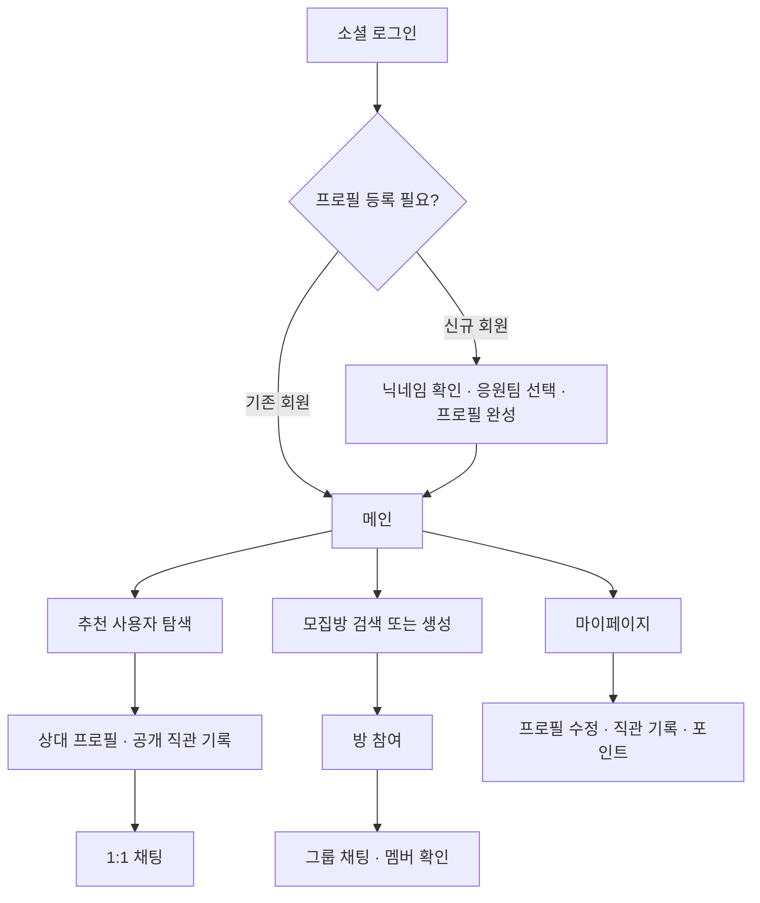

# jikchin
sports_mate_app

Flow Chart


## 백엔드 패키지 구조

도메인별로 관련 코드를 모으고, 각 도메인 안에서 Controller, Service, DTO, 도메인 모델, Repository의 역할을 구분합니다.

```text
com.jikchin.jikchin_app
├── auth
│   ├── config           # 인증 설정
│   ├── controller       # 로그인·최초 프로필 등록 API
│   ├── converter        # 소셜 로그인 제공자 변환
│   ├── domain           # 소셜 로그인 제공자 모델
│   ├── dto              # 인증 요청·응답·서비스 입출력
│   ├── infrastructure   # OAuth API·JWT 구현
│   ├── port             # OAuth·토큰 처리 인터페이스
│   ├── security         # 인증 필터·현재 사용자
│   └── service          # 로그인 처리
├── user                 # 회원·프로필: controller, dto, domain, repository, service
├── game                 # 경기·구단·리그·경기장: domain, repository
├── chat                 # 채팅방·참여자·메시지·첨부 모델
├── record               # 직관 기록·사진 모델
├── point                # 포인트 계정·원장·충전 모델
├── media                # 공용 미디어 모델
├── moderation           # 신고·차단 모델
└── global               # 공통 설정·생성/수정 시간 관리
```

- Controller는 Service를 호출하고, Service는 Spring Data Repository로 데이터를 조회·저장합니다.
- OAuth·JWT 처리는 `auth.port`의 인터페이스와 `auth.infrastructure`의 구현으로 분리합니다.
- HTTP 요청·응답 DTO와 JPA 엔티티는 분리하고, 도메인 모델은 Controller나 외부 API 구현을 참조하지 않습니다.
- 모집방 기능을 구현할 때는 별도 `room` 패키지에 추가합니다.

## 테스트

```powershell
.\gradlew.bat test
```

테스트는 `src/test/resources/application-test.yml`의 테스트 전용 H2 DB와 테스트용 인증 설정을 사용합니다. 로컬 MySQL이나 실제 소셜 로그인 계정 없이 실행할 수 있습니다.

로그인·프로필 등록 서비스, 기존 API의 경로·응답 형식·요청 검증, 전체 애플리케이션 기동을 확인합니다. 운영 DB는 기존과 같이 MySQL을 사용하며, H2 테스트는 실제 MySQL에서의 호환성 검증을 대체하지 않습니다.

CI에서도 테스트를 포함한 전체 빌드를 실행합니다.
