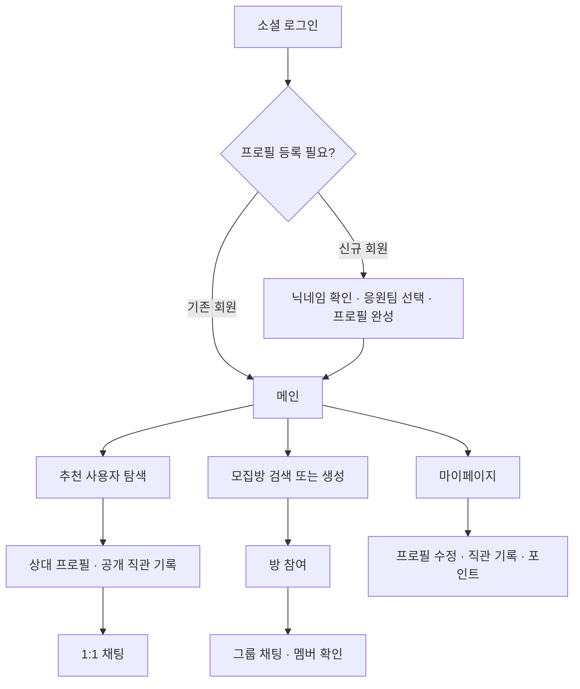

# jikchin
sports_mate_app

Flow Chart


## 백엔드 패키지 구조

도메인별로 관련 코드를 모으고, 각 도메인 안에서 Controller, Service, DTO, 도메인 모델, Repository의 역할을 구분합니다.

```text
com.jikchin.jikchin_app
├── auth
│   ├── config           # 인증 설정
│   ├── controller       # 로그인·최초 프로필 등록 API
│   ├── converter        # 소셜 로그인 제공자 변환
│   ├── domain           # 소셜 로그인 제공자 모델
│   ├── dto              # 인증 요청·응답·서비스 입출력
│   ├── infrastructure   # OAuth API·JWT 구현
│   ├── port             # OAuth·토큰 처리 인터페이스
│   ├── security         # 인증 필터·현재 사용자
│   └── service          # 로그인 처리
├── user                 # 회원·프로필: controller, dto, domain, repository, service
├── game                 # 경기·구단·리그·경기장: domain, repository
├── chat                 # 채팅방·참여자·메시지·첨부 모델
├── record               # 직관 기록·사진 모델
├── point                # 포인트 계정·원장·충전 모델
├── media                # 공용 미디어 모델
├── moderation           # 신고·차단 모델
└── global               # 공통 설정·생성/수정 시간 관리
```

- Controller는 Service를 호출하고, Service는 Spring Data Repository로 데이터를 조회·저장합니다.
- OAuth·JWT 처리는 `auth.port`의 인터페이스와 `auth.infrastructure`의 구현으로 분리합니다.
- HTTP 요청·응답 DTO와 JPA 엔티티는 분리하고, 도메인 모델은 Controller나 외부 API 구현을 참조하지 않습니다.
- 모집방 기능을 구현할 때는 별도 `room` 패키지에 추가합니다.

## DB 마이그레이션

MySQL 스키마는 Flyway로 관리합니다. 애플리케이션 시작 시 `src/main/resources/db/migration`의 SQL을 버전 순서대로 적용한 뒤, JPA가 엔티티와 DB 구조를 검증합니다. `V1__init_schema.sql`은 현재 엔티티 18개의 테이블, 외래 키, 고유 제약 조건과 인덱스를 생성합니다. 팀·리그 등 기준 데이터는 포함하지 않습니다.

로컬 MySQL에 빈 DB를 먼저 준비합니다.

```sql
CREATE DATABASE IF NOT EXISTS jikchin
    CHARACTER SET utf8mb4
    COLLATE utf8mb4_unicode_ci;
```

IntelliJ의 애플리케이션 실행 환경변수에 DB 연결값과 기존 인증·이미지 설정을 지정합니다.

| 환경변수 | 값 |
| --- | --- |
| `DB_URL` | `jdbc:mysql://127.0.0.1:3306/jikchin?serverTimezone=Asia/Seoul&characterEncoding=UTF-8` |
| `DB_USERNAME` | 로컬 MySQL 사용자 |
| `DB_PASSWORD` | 해당 사용자의 비밀번호 |
| `JWT_SECRET` | JWT 서명용 랜덤 비밀키 |
| `GOOGLE_CLIENT_ID` | Google OAuth 웹 클라이언트 ID |
| `ASSETS_BASE_URL` | 이미지 제공 기본 URL |

`JPA_DDL_AUTO`의 기본값은 `validate`입니다. 이전에 실행 설정에 `JPA_DDL_AUTO=update`나 `create`를 넣었다면 삭제하거나 `validate`로 바꿉니다. 테이블 변경은 Flyway가 담당하도록 유지합니다. 로컬 기동 확인용 OAuth·이미지 임시값을 쓰는 경우 실제 기능 연동 전에 교체합니다.

서버 실행 후 다음 SQL로 적용 결과를 확인할 수 있습니다.

```sql
SHOW TABLES FROM jikchin;
SELECT version, description, script, checksum, installed_on, success
FROM jikchin.flyway_schema_history
ORDER BY installed_rank;
```

- 새 변경은 `V2__설명.sql`, `V3__설명.sql`처럼 버전 뒤에 밑줄 두 개를 붙인 새 파일로 작성합니다. SQL과 엔티티 변경을 함께 커밋합니다.
- 이미 적용한 버전의 파일을 수정하지 않습니다. Flyway는 체크섬으로 기존 파일의 변경을 검사합니다.
- 재시작 시 적용 완료한 SQL은 다시 실행하지 않습니다.
- 기존 테이블이 있는데 Flyway 이력이 없는 DB는 자동 baseline하지 않고 시작을 중단합니다. 기존 데이터가 있다면 백업과 스키마 비교 후 명시적으로 baseline을 계획합니다. 새 개발 환경은 빈 DB로 연결하면 됩니다.
- Flyway의 `clean`은 비활성화되어 있습니다. MySQL DDL은 실패 시 전체 롤백되지 않을 수 있으므로 실패한 마이그레이션은 오류와 실제 적용 상태를 확인한 뒤 복구합니다.

## 테스트

```powershell
.\gradlew.bat test
```

테스트는 `src/test/resources/application-test.yml`의 테스트 전용 H2 DB와 테스트용 인증 설정을 사용합니다. 로컬 MySQL이나 실제 소셜 로그인 계정 없이 실행할 수 있습니다.

로그인·프로필 등록 서비스, 기존 API의 경로·응답 형식·요청 검증, 전체 애플리케이션 기동을 확인합니다. 운영 DB는 기존과 같이 MySQL을 사용하며, H2 테스트는 실제 MySQL에서의 호환성 검증을 대체하지 않습니다.

CI에서도 테스트를 포함한 전체 빌드를 실행합니다.

### MySQL 마이그레이션 통합 테스트

H2 테스트는 Flyway를 비활성화하고 JPA로 테스트 스키마를 생성합니다. 실제 MySQL 마이그레이션은 별도의 `mysqlTest` 태스크로 검증합니다. 이 테스트는 사용자·프로필 데이터를 저장하므로 일반 개발 DB와 분리된 테스트 전용 DB를 사용합니다.

```sql
CREATE DATABASE jikchin_migration_test
    CHARACTER SET utf8mb4
    COLLATE utf8mb4_unicode_ci;
```

```powershell
$env:MYSQL_TEST_URL = 'jdbc:mysql://127.0.0.1:3306/jikchin_migration_test?serverTimezone=Asia/Seoul&characterEncoding=UTF-8'
$env:MYSQL_TEST_USERNAME = '테스트 DB 사용자'
$env:MYSQL_TEST_PASSWORD = '테스트 DB 비밀번호'
.\gradlew.bat mysqlTest
```

초기 마이그레이션과 JPA 검증, 재실행 시 데이터 보존, 닉네임 고유 제약 조건, 긴 메시지·이모지 저장을 확인합니다. CI에서도 MySQL 8.0 서비스의 전용 DB로 같은 테스트를 실행합니다.
